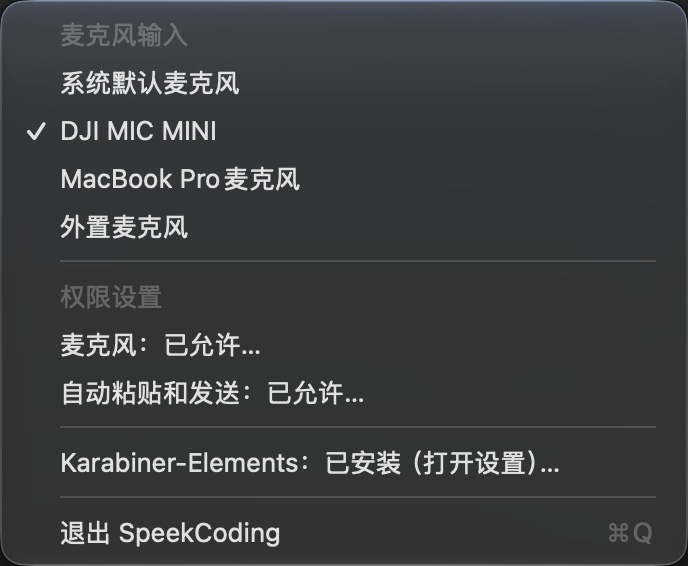

# SpeekCoding

[English](README.en.md) · 简体中文

> 按一下开始说，再按一下把代码意图送进当前应用。

SpeekCoding 是面向 macOS 的本地优先语音输入工具：按一下开始说话，再按一下停止录音。应用会将语音转成文字，放入剪贴板，并按你的设置粘贴或发送到开始录音时的应用。它适用于 Codex、Claude Code、Cursor、终端，以及其他支持粘贴的输入框。

- **语音转写**：默认使用本机 faster-whisper，支持中英文混合口述和代码相关词汇；也可配置其他兼容服务。
- **全局触发**：单独按键盘 Fn 键，或另外配置 DJI Mic Mini 发射器的连接键。Fn 组合键保留系统和应用原有行为。全局按键由 Karabiner-Elements 提供。
- **可选交付方式**：默认自动粘贴并按 Return；也可以只粘贴，或只复制到剪贴板。
- **菜单栏操作**：选择麦克风、在“功能设置”中切换自动发送、查看和设置权限、检查 Karabiner-Elements，以及退出应用。
- **录音反馈**：录音和转写期间显示状态提示；首次使用默认模型时会下载模型文件。

> 当前项目处于 `0.x` 阶段。正式发布的安装包应经过 Developer ID 签名和公证；使用远程转写服务时，音频会发送到你配置的服务。

GitHub 仓库以当前代码快照作为新的历史起点，早期开发分支、标签及预发布包已撤下。新的安装包尚未发布时，请使用[源码构建流程](CONTRIBUTING.md#本地开发)。带 `-dev-` 的开发预发布包未经过 Developer ID 签名或公证，请先阅读对应发布说明。

## 安装和首次设置

需要 macOS 13 或更高版本，以及一个可用的麦克风。最终用户无需安装 Node.js、Python、Homebrew 或 Xcode。Fn 和 DJI 按钮触发需要 [Karabiner-Elements](https://karabiner-elements.pqrs.org/)；DJI 按钮还需要连接 DJI Mic Mini 接收器。

1. **下载安装包。** 从项目的 [Releases](https://github.com/yizhouxw/speek-coding/releases) 页面选择与你的 Mac 架构匹配的 `SpeekCoding-<版本>-<架构>.pkg`：Apple Silicon 使用 `arm64`，Intel 使用 `x86_64`。不确定架构时，可在终端运行 `uname -m`。如果尚无适合你电脑的发布包，请参考[源码构建说明](CONTRIBUTING.md)。
2. **安装并打开应用。** 双击 `.pkg`，按安装器提示完成安装，然后从“应用程序”打开 SpeekCoding。它在菜单栏显示为代码尖括号和声波图标，而不是普通窗口。安装包还会安装 `speek` 命令。
3. **安装并打开 Karabiner-Elements。** 点击 SpeekCoding 菜单栏中的 Karabiner-Elements 条目；未安装时，可按照提示下载并打开官方安装器。安装完成后打开 Karabiner-Elements，并按其提示完成后台服务、辅助功能、输入监控和驱动扩展等系统授权。不要把这些授权与 SpeekCoding 自身权限混淆。
4. **完成 SpeekCoding 设置。** 打开“终端”，运行：

   ```bash
   speek setup
   ```

   按提示选择键盘或键盘加 DJI 的触发方式、Karabiner 配置和其他选项。已连接 DJI Mic Mini 时也可以明确指定：

   ```bash
   speek setup --trigger-mode keyboard+dji --input-device "DJI Mic Mini"
   ```

5. **允许 SpeekCoding 使用麦克风和自动粘贴。** 点击菜单栏中的“麦克风”和“自动粘贴和发送”，按 macOS 提示授权。权限状态也可以在 **System Settings → Privacy & Security → Microphone / Accessibility** 中检查。选择仅复制到剪贴板时，不需要自动粘贴所需的控制电脑和模拟按键权限。
6. **选择麦克风并开始使用。** 在菜单栏选择目标麦克风，打开一个可输入文字的应用，点击输入框，然后按 Fn 或已配置的 DJI 按钮开始说话，再按一次结束。默认模式会粘贴转写文字并按 Return；取消菜单中的“自动发送”即可只粘贴，其他选项见[发送策略](#发送策略)。

第一次真实转写可能需要联网下载和加载模型，所需时间取决于网络和机器性能；下载期间可再次按触发键取消。安装包包含应用及本地转写运行时，但不包含模型权重。

可以在终端确认安装、权限、设备和本地服务：

```bash
speek status
speek doctor
```

如果要验证麦克风，运行 `speek test-record --duration 2 --wav /tmp/speek-test.wav`；该命令会保留指定路径的测试录音。

## 菜单栏

点击菜单栏中的 SpeekCoding 图标打开菜单：



| 菜单项 | 功能 |
| --- | --- |
| **麦克风输入** | 选择系统默认麦克风或已连接设备。勾选表示当前选择；设备断开时会标记为未连接。新选择从下一次录音生效。 |
| **自动发送（粘贴时附加回车）** | 位于“功能设置”下，默认勾选，粘贴后按 Return；取消勾选后只粘贴。通过命令行设置为仅复制到剪贴板时显示横线，点击可启用自动发送。设置从下一次录音生效。 |
| **麦克风** | 显示 SpeekCoding 的麦克风权限；首次点击可请求授权，已拒绝时打开系统设置。 |
| **自动粘贴和发送** | 显示控制电脑和模拟按键的权限状态；点击后打开相关系统设置。文字会先复制到剪贴板，再依照发送策略粘贴或按 Return。 |
| **Karabiner-Elements** | 显示安装状态；已安装时打开 Karabiner 设置，未安装时提供官方下载与安装引导。安装后仍需在 Karabiner 中完成系统授权并运行 `speek setup`。 |
| **退出 SpeekCoding** | 退出菜单栏应用并停止由应用管理的本地转写服务。重新打开应用时会启动已安装的本地服务。 |

截图中的设备名称仅为示例；实际菜单会根据连接设备和权限状态变化。更改权限后重新打开菜单即可刷新状态。若应用没有出现在菜单栏，请先从“应用程序”打开 SpeekCoding。

## 日常使用

录音或转写期间可点击悬浮窗中的 Cancel 取消；录音超过 5 分钟会自动取消。

```bash
speek status                 # 查看产品状态和下一步动作
speek permissions            # 由 App 发起并检查 macOS 权限请求
speek trigger                # 通过鉴权 Unix socket 切换录音状态
speek cancel                 # 取消当前录音或转写
speek config                 # 交互修改输入、发送策略、提示音和 HUD
speek restart                # 修改 ASR 配置后重载后台服务
speek logs                   # 最近 80 行 ASR 日志
speek logs --follow          # 持续查看 ASR 日志
speek doctor                 # 完整诊断 App、签名、IPC、权限和服务
speek update                 # 安装新 .pkg 后刷新 IPC 客户端和 Karabiner 规则
```

本地 ASR 服务优先安装到 `~/Library/LaunchAgents/com.speek.coding.asr.plist`。如果当前宿主被 macOS 禁止写入登录项，会回退到 `~/.config/speek-coding/com.speek.coding.asr.plist` 并在当前登录会话运行。日志位于 `~/.config/speek-coding/logs/`；`speek stop` 和 `speek start` 可以暂停或恢复本地 ASR。

SpeekCoding App 启动时会启动已安装的本地 ASR 服务，退出时会停止该服务。使用远程 ASR 或模拟转写时，App 启动不会启动本地服务。

## 输入设备与触发方式

SpeekCoding 始终支持键盘工作流，也可以把 DJI Mic Mini 作为额外触发器：

只有单独按下并释放 Fn 才触发；Fn+F12 等组合键不触发录音。系统设置、键盘型号或其他 Karabiner 规则可能影响事件，排查方式见[故障排查](docs/TROUBLESHOOTING.md)。

```bash
speek setup --trigger-mode keyboard
speek setup --trigger-mode keyboard+dji --input-device "DJI Mic Mini"
```

DJI 接收器通过 USB-C 连接 Mac 后，发射器连接键通常会暴露为以下 Consumer HID 事件：

```text
vendor_id = 11427
product_id = 16401
consumer_key_code = volume_increment
```

如果使用其他麦克风，只需传入 CoreAudio 设备名的一部分：

```bash
speek config --input-device "MacBook Pro Microphone"
```

## 转写引擎

### 默认：faster-whisper

`speek setup` 直接启用安装包内的 Python 和 faster-whisper，并让它作为本地后台服务运行，不会在用户机执行 `pip install`。默认模型是 `whisper-large-v3-turbo`；首次真实转写时仍会下载模型权重。

首次下载和加载模型时，悬浮提示会显示当前阶段；等待期间再次按 Fn（或 DJI 触发键）即可取消本次转写和正在进行的模型下载，也可以运行 `speek cancel`。下次转写会重新尝试下载，已缓存的文件可复用。下载受网络和磁盘空间影响，首次准备可能需要几分钟。

低配置机器可以先用小模型验证：

```bash
speek config --asr-model tiny
speek restart
```

### Apple Silicon：whisper.cpp

准备好 `whisper-cli` 和 `ggml-*.bin` 后：

```bash
speek config \
  --asr-backend whisper-cpp \
  --asr-model "$HOME/.cache/speek-coding/models/whisper.cpp/ggml-large-v3-turbo.bin" \
  --whisper-cpp-bin "$HOME/.cache/speek-coding/src/whisper.cpp/build/bin/whisper-cli" \
  --asr-best-of 1
speek restart
```

中英混合口述建议使用自动语言识别；`auto` 会规范化为空语言提示，本地 whisper.cpp 会显式使用 `-l auto`，外部兼容 API 则不会收到固定的语言代码：

```bash
speek config --asr-language auto \
  --asr-prompt "中英混合软件工程口述 / Mixed Chinese-English software engineering dictation. 保持原始中英文切换，保留 code identifiers、commands、filenames 和 product names，不要互相翻译中英文。"
speek restart
```

### 外部 OpenAI-compatible ASR

SpeekCoding 也可以连接已有的转写服务。远程服务必须使用 HTTPS；明文 HTTP 只允许 `localhost` / loopback 地址：

```bash
speek setup --skip-asr \
  --asr-url http://127.0.0.1:9000/v1/audio/transcriptions \
  --asr-model your-model
```

接口约定：`POST /v1/audio/transcriptions`，multipart 字段包含 `model` 和 `file`，响应为 `{"text":"..."}` 或纯文本。HTTP 请求由 `SpeekCoding.app` 发起；本地 ASR LaunchAgent 只接收 WAV 并返回文本。

## 发送策略

```bash
speek config --delivery-mode paste_and_send  # 粘贴并发送 Return（默认）
speek config --delivery-mode paste_only      # 只粘贴
speek config --delivery-mode clipboard_only  # 只写入剪贴板
```

开始录音时，App 会锁定当时的前台应用 PID。转写完成后，粘贴和 Return 的 CGEvent 会定向发送给该进程；`clipboard_only` 不发送 CGEvent。

需要先验证硬件与权限而不运行真实 ASR 时：

```bash
speek config --fake-transcript "请继续"
# 验证完恢复
speek config --fake-transcript ""
```

## 隐私边界

默认转写请求只访问本机 `http://127.0.0.1:8000`；首次准备模型需要访问模型下载服务，点击下载安装 Karabiner 时也会访问其下载地址。项目没有内置使用行为分析或录音上传服务。内置 ASR 服务只允许绑定 loopback，限制单次请求大小，并锁定启动时配置的模型。录音临时文件和运行状态写在每用户目录 `/tmp/speek-coding-<uid>/`，常规会话结束后即清理；只有明确运行 `speek test-record` 才保留测试 WAV。模型缓存和剪贴板内容不会随会话自动清空。若把 `--asr-url` 指向远端服务，App 会把音频发送到该地址，数据策略由对应服务负责。

## 卸载

```bash
speek uninstall
```

`speek uninstall` 会停止 ASR 服务并移除当前用户的 LaunchAgent、鉴权 token、Karabiner 托管规则和客户端、HUD、配置及日志，但不会删除由系统安装器管理的 `/Applications/SpeekCoding.app` 和 `/usr/local/bin` 命令。完整移除发布包可再执行 `sudo rm -rf /Applications/SpeekCoding.app /usr/local/bin/speek /usr/local/bin/speek-coding`。模型缓存默认保留，便于以后重新安装。

## 文档

- [功能规格](docs/FEATURE_SPEC.md)
- [产品边界与用户旅程](docs/PRODUCT.md)
- [开发说明](docs/DEVELOPMENT.md)
- [原生输入实验（未接入产品）](docs/NATIVE_INPUT_EXPERIMENT.md)
- [架构与数据流](docs/ARCHITECTURE.md)
- [故障排查](docs/TROUBLESHOOTING.md)
- [参与开发](CONTRIBUTING.md)
- [安全策略](SECURITY.md)
- [发布流程](docs/RELEASING.md)
- [行为准则](CODE_OF_CONDUCT.md)
- [版本记录](CHANGELOG.md)
- [获取帮助与反馈](SUPPORT.md)
- [开源维护检查](docs/OPEN_SOURCE.md)

## 致谢

硬件触发工作流源自 [Johnixr/dji-mic-dictation](https://github.com/Johnixr/dji-mic-dictation)，SpeekCoding 将 SaaS 转写替换为本地优先 ASR，并补齐原生 App、稳定产品身份、后台服务、状态诊断和生命周期管理。

SpeekCoding 与 Apple、DJI、Karabiner-Elements、OpenAI 及模型提供方均无隶属或背书关系；相关名称和商标归各自权利人所有。

## License

[MIT](LICENSE)
