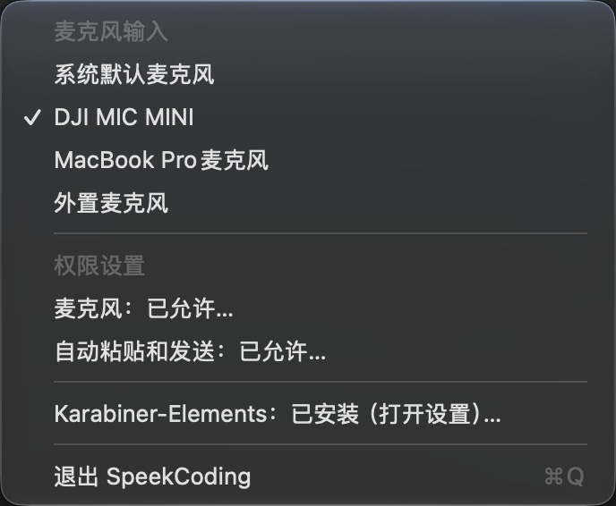

# SpeekCoding 使用指南

[返回产品介绍与安装步骤](../README.zh-CN.md) · [English overview](../README.md)

麦克风验证可运行 `speek test-record --duration 2 --wav /tmp/speek-test.wav`；该命令会保留指定路径的测试录音。

## 菜单栏

点击菜单栏中的 SpeekCoding 图标打开菜单：



| 菜单项 | 功能 |
| --- | --- |
| **麦克风输入** | 选择系统默认麦克风或已连接设备。勾选表示当前选择；设备断开时会标记为未连接。新选择从下一次录音生效。 |
| **自动发送（粘贴时附加回车）** | 位于“功能设置”下，默认勾选，粘贴后按 Return；取消勾选后只粘贴。通过命令行设置为仅复制到剪贴板时显示横线，点击可启用自动发送。设置从下一次录音生效。 |
| **语言** | 位于“功能设置”下，支持“跟随 macOS”、简体中文、繁體中文和 English。切换无需重启，选择会在重新启动后保留。 |
| **麦克风** | 显示 SpeekCoding 的麦克风权限；首次点击可请求授权，已拒绝时打开系统设置。 |
| **自动粘贴和发送** | 显示控制电脑和模拟按键的权限状态；点击后打开相关系统设置。文字会先复制到剪贴板，再依照发送策略粘贴或按 Return。 |
| **Karabiner-Elements** | 显示安装状态；已安装时打开 Karabiner 设置，未安装时提供官方下载与安装引导。安装后仍需在 Karabiner 中完成系统授权并运行 `speek setup`。 |
| **退出 SpeekCoding** | 退出菜单栏应用并停止由应用管理的本地转写服务。重新打开应用时会启动已安装的本地服务。 |

截图中的设备名称仅为示例；实际菜单会根据连接设备和权限状态变化。更改权限后重新打开菜单即可刷新状态。若应用没有出现在菜单栏，请先从“应用程序”打开 SpeekCoding。

菜单及其相关对话框默认跟随 macOS 首选语言顺序，选择支持的简体中文、繁体中文或英语。台湾、香港、澳门地区的中文偏好使用繁体；没有支持的首选语言时回退到英语。在“功能设置 → 语言”中可手动切换，也可选回“跟随 macOS”。界面语言不改变语音识别语言，麦克风名称由系统或设备提供。

## 日常使用

录音或转写期间可点击悬浮窗中的 Cancel 取消；录音超过 5 分钟会自动取消。

```bash
speek status                 # 查看产品状态和下一步动作
speek permissions            # 由 App 发起并检查 macOS 权限请求
speek trigger                # 通过鉴权 Unix socket 切换录音状态
speek cancel                 # 取消当前录音或转写
speek config                 # 交互修改输入、发送策略、提示音和 HUD
speek restart                # 修改 ASR 配置后重载后台服务
speek logs                   # 最近 80 行 ASR 日志
speek logs --follow          # 持续查看 ASR 日志
speek doctor                 # 完整诊断 App、签名、IPC、权限和服务
speek update                 # 安装新 .pkg 后刷新 IPC 客户端和 Karabiner 规则
```

本地 ASR 服务优先安装到 `~/Library/LaunchAgents/com.speek.coding.asr.plist`。如果当前宿主被 macOS 禁止写入登录项，会回退到 `~/.config/speek-coding/com.speek.coding.asr.plist` 并在当前登录会话运行。日志位于 `~/.config/speek-coding/logs/`；`speek stop` 和 `speek start` 可以暂停或恢复本地 ASR。

SpeekCoding App 启动时会启动已安装的本地 ASR 服务，退出时会停止该服务。使用远程 ASR 或模拟转写时，App 启动不会启动本地服务。

## 输入设备与触发方式

SpeekCoding 始终支持键盘工作流，也可以把 DJI Mic Mini 作为额外触发器：

只有单独按下并释放 Fn 才触发；Fn+F12 等组合键不触发录音。系统设置、键盘型号或其他 Karabiner 规则可能影响事件，排查方式见[故障排查](TROUBLESHOOTING.md)。

```bash
speek setup --trigger-mode keyboard
speek setup --trigger-mode keyboard+dji --input-device "DJI Mic Mini"
```

DJI 接收器通过 USB-C 连接 Mac 后，发射器连接键通常会暴露为以下 Consumer HID 事件：

```text
vendor_id = 11427
product_id = 16401
consumer_key_code = volume_increment
```

如果使用其他麦克风，只需传入 CoreAudio 设备名的一部分：

```bash
speek config --input-device "MacBook Pro Microphone"
```

## 转写引擎

### Apple Silicon 默认：Qwen3-ASR-0.6B / MLX

默认使用开源的 `mlx-community/Qwen3-ASR-0.6B-4bit`，通过 MLX 利用 Apple GPU。模型版本固定为 `313d850181767edf09f00a9c289becca70e58cd0`，首次使用时下载权重，已缓存模型在后台服务启动时预热；安装包内置 Python 和模型运行依赖，不会在用户机执行 `pip install`。

按 Fn 开始后，App 持续向本机服务发送 16 kHz 单声道 PCM16 音频；模型每秒更新一次草稿，悬浮窗显示最新文字。草稿可以结合上下文纠错。再次按 Fn 时发送剩余音频、取得最终结果，再复制、粘贴或发送。流式连接失败时，会使用本次录音尝试文件转写；取消时清理会话及临时录音。音频不会发送到云端。

已有安装会保留原引擎。更新应用后切换：

```bash
speek config --asr-backend qwen-mlx --asr-model mlx-community/Qwen3-ASR-0.6B-4bit
speek asr-install
speek restart
```

源码安装时 `asr-install` 会在产品私有 Python 环境安装 MLX 依赖。修改配置文件中的 `SPEEK_ASR_STREAMING=0` 可关闭实时转写，使用同一 Qwen 模型进行文件转写。Qwen 输入固定为 16 kHz；保留默认 `SPEEK_AUDIO_SAMPLE_RATE=16000`。

首次下载和加载期间会显示准备状态。转写等待期间再次按 Fn 可以取消；录音期间按 Fn 表示停止并定稿，悬浮窗 Cancel 按钮随时取消本次录音。

### Intel 默认 / 可选：faster-whisper

Intel 默认使用 `whisper-large-v3-turbo`。Apple Silicon 也可显式选择 Whisper，例如：

```bash
speek config --asr-backend faster-whisper --asr-model small
speek asr-install
speek restart
```

Whisper 和外部文件接口继续采用停止录音后转写的流程。

### Apple Silicon：whisper.cpp

准备好 `whisper-cli` 和 `ggml-*.bin` 后：

```bash
speek config \
  --asr-backend whisper-cpp \
  --asr-model "$HOME/.cache/speek-coding/models/whisper.cpp/ggml-large-v3-turbo.bin" \
  --whisper-cpp-bin "$HOME/.cache/speek-coding/src/whisper.cpp/build/bin/whisper-cli" \
  --asr-best-of 1
speek restart
```

中英混合口述建议使用自动语言识别；`auto` 会规范化为空语言提示，本地 whisper.cpp 会显式使用 `-l auto`，外部兼容 API 则不会收到固定的语言代码：

```bash
speek config --asr-language auto \
  --asr-prompt "中英混合软件工程口述 / Mixed Chinese-English software engineering dictation. 保持原始中英文切换，保留 code identifiers、commands、filenames 和 product names，不要互相翻译中英文。"
speek restart
```

### 智能纠错和模型管理

Apple Silicon 使用本地 Qwen 引擎时，“功能设置 → 智能纠错”控制是否在定稿后调用小型 Chat 模型。模型按通用校对提示处理全文，去除无意义停顿和口吃，修复断句与上下文识别错误；不使用固定术语替换表。模型仍可能误改，重要内容建议使用“只粘贴”检查后发送。

“功能设置 → 模型管理”分为：

- **语音识别模型**：Qwen3-ASR 0.6B / 1.7B，均为 4-bit。
- **文本生成模型**：Qwen3-4B-Instruct-2507（默认）以及 Qwen3 0.6B / 1.7B，均为 4-bit。更小的模型通常更快，但纠错质量需要结合实际口述判断。

未缓存的模型显示“下载”，完成后显示“选择”；点击选择后保存设置。下载期间显示“处理中”，失败会弹出错误，可重新尝试。下载不会自动改变当前选择。录音期间不能切换语音模型。首次下载需要联网，纠错本身只读取本地缓存，不上传音频或文字。

```bash
speek config --transcript-cleanup off  # 关闭智能纠错，直接使用识别原文
speek config --transcript-cleanup on   # 开启智能纠错，需先下载文本模型
```

配置对应 `SPEEK_TRANSCRIPT_CLEANUP` 与 `SPEEK_TEXT_MODEL`，菜单和 CLI 使用同一配置。结束录音后显示纠错状态，Fn 或 Cancel 可取消。模型未下载、生成失败或超出处理长度时，原始转写会复制到剪贴板并提示失败，不自动发送。单次纠错最多 12,000 字符；目前 Intel、Whisper 和远程 ASR 不启用此 MLX 纠错功能。

### 外部 OpenAI-compatible ASR

SpeekCoding 也可以连接已有的转写服务。远程服务必须使用 HTTPS；明文 HTTP 只允许 `localhost` / loopback 地址：

```bash
speek setup --skip-asr \
  --asr-url http://127.0.0.1:9000/v1/audio/transcriptions \
  --asr-model your-model
```

接口约定：`POST /v1/audio/transcriptions`，multipart 字段包含 `model` 和 `file`，响应为 `{"text":"..."}` 或纯文本。HTTP 请求由 `SpeekCoding.app` 发起；本地 ASR LaunchAgent 接收 PCM 音频流或 WAV 并返回文本。

## 发送策略

```bash
speek config --delivery-mode paste_and_send  # 粘贴并发送 Return（默认）
speek config --delivery-mode paste_only      # 只粘贴
speek config --delivery-mode clipboard_only  # 只写入剪贴板
```

开始录音时，App 会锁定当时的前台应用 PID。转写完成后，粘贴和 Return 的 CGEvent 会定向发送给该进程；`clipboard_only` 不发送 CGEvent。

需要先验证硬件与权限而不运行真实 ASR 时：

```bash
speek config --fake-transcript "请继续"
# 验证完恢复
speek config --fake-transcript ""
```

## 隐私边界

默认转写请求只访问本机 `http://127.0.0.1:8000`；首次准备模型需要访问模型下载服务，点击下载安装 Karabiner 时也会访问其下载地址。项目没有内置使用行为分析或录音上传服务。内置 ASR 服务只允许绑定 loopback，限制单次请求大小，并仅允许通过模型管理切换已列出的本地语音模型。录音临时文件和运行状态写在每用户目录 `/tmp/speek-coding-<uid>/`，常规会话结束后即清理；只有明确运行 `speek test-record` 才保留测试 WAV。模型缓存和剪贴板内容不会随会话自动清空。若把 `--asr-url` 指向远端服务，App 会把音频发送到该地址，数据策略由对应服务负责。

## 卸载

```bash
speek uninstall
```

`speek uninstall` 会停止 ASR 服务并移除当前用户的 LaunchAgent、鉴权 token、Karabiner 托管规则和客户端、HUD、配置及日志，但不会删除由系统安装器管理的 `/Applications/SpeekCoding.app` 和 `/usr/local/bin` 命令。完整移除发布包可再执行 `sudo rm -rf /Applications/SpeekCoding.app /usr/local/bin/speek /usr/local/bin/speek-coding`。模型缓存默认保留，便于以后重新安装。
